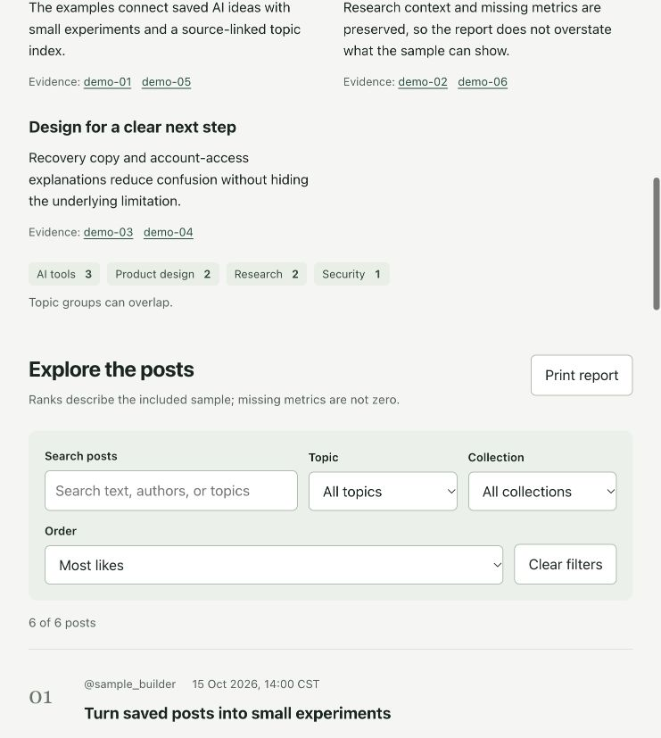

# AIsa X Assistant

A read-only agent skill for organizing X/Twitter content through AIsa MCP. It offers short, skippable setup questions and produces source-linked Markdown briefs and self-contained HTML reports.

The skill is written in English. Reports and interactive questions follow the user's language.

## What it does

- Reuses a working AIsa connection before starting onboarding.
- Defaults to a confirmed personal X account, with support for another account's handle, profile URL, or explicit numeric ID.
- Groups posts by topic and ranks the retrieved collection by received likes, reposts, replies, views, or publication time.
- Distinguishes public profile posts, Following and For You feeds, liked posts, reposts/quotes, and viewing history.
- Checks the actual endpoint and account permissions before claiming access to a collection.
- Exports Markdown and offline HTML with search, topic/type filters, sorting, source links, and printing.

Home feeds, likes, and viewing history depend on the interfaces and permissions available through the current AIsa connection. An AIsa or GitHub login does not establish X account authorization. This skill does not post, like, follow, send messages, or schedule background work.

## Install

The installable skill directory is [`aisa-x-assistant/`](aisa-x-assistant). Install that directory with your agent host's supported local skill workflow.

For Codex, ask the built-in installer:

```text
Use $skill-installer to install the skill from
https://github.com/zouhangwithsweet/aisa-x-assistant
at path aisa-x-assistant.
```

See the [Codex skills documentation](https://learn.chatgpt.com/docs/build-skills) for local discovery and invocation. If the skill does not appear after installation, restart the host and try a new chat.

## Connect AIsa

Reuse an existing working AIsa MCP or plugin connection. Otherwise, use your host's connection settings and AIsa's supported sign-in flow. Browser OAuth is the first onboarding option; a personal API key is optional and should be configured securely through the host, never pasted into the skill or reports.

- [AIsa MCP connection guide](https://www.aisa.one/mcp#connect)
- [AIsa agent quickstart](https://aisa.one/docs/agent-quickstart.md)

The skill discovers current tool contracts, retrieves missing schemas, and quotes the exact calls before paid execution. Estimates are not guaranteed spending caps. Existing authorization is reused when it covers the requested scope and cost risk.

## Try it

Interactive setup:

```text
Use $aisa-x-assistant to organize X content with me.
First let me choose my own account or another account.
Allow me to skip optional preferences. Group the content by topic,
and give me Markdown and filterable HTML. Quote paid calls first.
```

A specific public-post request:

```text
Use $aisa-x-assistant to summarize @example's latest 5 public posts.
Group them by topic and include source links. Give me Markdown and HTML.
```

No connection is needed for a fictional presentation preview:

```text
Use $aisa-x-assistant. Skip account connection and show me a fictional report.
```

Defaults for a general personal brief are the confirmed self account, Following feed, the last seven days in the user's timezone, up to 50 qualifying posts, newest first, and inferred topics. Unsupported access is reported explicitly and does not become an empty result or a different collection.

## Offline example

All posts, account names, metrics, and source destinations in [`preview/`](preview) are fictional. The example does not contain live personal account data.

Open [`preview/report.html`](preview/report.html) locally, or regenerate both formats with Python 3.9 or later:

```sh
python3 aisa-x-assistant/scripts/render_report.py \
  --input preview/sample-input.json \
  --output preview \
  --format both
```

The renderer uses only the Python standard library and makes no network requests. It accepts normalized evidence, validates IDs, timestamps and metrics, escapes content, and leaves missing metrics unknown. It does not fetch or classify posts itself.



## Project files

- [`SKILL.md`](aisa-x-assistant/SKILL.md): agent workflow.
- [`references/interaction.md`](aisa-x-assistant/references/interaction.md): defaults and example exchanges.
- [`references/connection.md`](aisa-x-assistant/references/connection.md): connection reuse, discovery, quotes and error handling.
- [`references/reporting.md`](aisa-x-assistant/references/reporting.md): evidence and normalized report contract.
- [`scripts/render_report.py`](aisa-x-assistant/scripts/render_report.py): offline Markdown and HTML renderer.
- [`REVIEW.md`](REVIEW.md): validation scope and known limitations.

Keep credentials, local configuration, raw account responses, and personal report outputs outside this repository.
